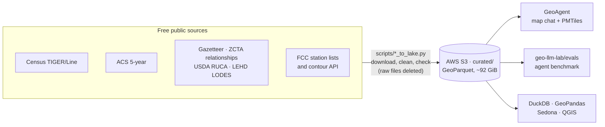

# GeoDataAnalytics

**The public data engineering behind [GeoAgent](https://geoagent.app).** This
repo builds a national US geographic data layer from free federal sources and
stores it as GeoParquet on S3. DuckDB queries it in place, and the repo also
grades how well LLM agents answer geographic questions against it.

GeoAgent is a map you can ask questions. You might ask "How many jobs are in
Phoenix?", or draw a shape and ask who lives inside it, or ask which radio
stations cover a ZIP code. An LLM can't answer these from memory, for three
reasons:

- **The numbers are too specific.** A model can't reliably recall a job count
  for one city.
- **They change with every release.** Census and LEHD publish new figures
  every year.
- **The names are ambiguous.** "Phoenix" could mean the city, the county or
  the metro area.

The agent needs a clean, versioned data layer where every place has a key it
can look up. This repo builds that layer and tests the agent against it.
GeoAgent's app code is private; all of its data engineering is here.

## What it does

1. **Collects** data from the Census Bureau, LEHD, USDA and the FCC:
   - boundaries
   - demographics
   - jobs and commutes
   - rural/urban codes
   - broadcast licenses
2. **Cleans and joins it once.** Every table shares one key: layer, vintage
   and GEOID. GEOIDs are stored as text with their leading zeros, placeholder
   codes are dropped and vintages are never mixed.
3. **Publishes only the curated result** to one S3 bucket as (Geo)Parquet.
   Raw downloads stay in local staging and are deleted after publishing.
4. **Tests the agent.** An eval suite asks geographic questions in plain
   English and grades the answers against SQL run live on the same lake.



## What's in the lake

All paths are under `s3://<bucket>/curated/`. Sizes are as of November 2026.

| Dataset | Coverage | Size | Built by |
|---|---|---|---|
| **Boundaries**<br/>`boundaries/` | 22 TIGER/Line layers:<br/>• **2011–2025:** state, county, tract, block group, place, CBSA, congressional and state legislative districts<br/>• **2020–2025:** ZCTA<br/>• **2025 only:** urban areas, CSA, metro divisions, county subdivisions, PUMAs and tribal areas<br/>Every row carries H3 (res 5 and 7) and bounding-box keys. | 18.5 GiB | [`scripts/tiger_to_lake.py`](scripts/tiger_to_lake.py) |
| **ACS 5-year**<br/>`acs/` | 1,201 tables in all:<br/>• **2020–2024:** every table at every geography, with margins of error<br/>• **2014–2019:** GeoAgent's 12 core tables at 8 levels | 71.6 GiB | [`warehouse/load/load_acs_summary_file.py`](warehouse/load/load_acs_summary_file.py),<br/>[`scripts/acs_api_to_lake.py`](scripts/acs_api_to_lake.py) |
| **Reference**<br/>`reference/` | • Census Gazetteer 2025<br/>• 2020 ZCTA relationship files<br/>• USDA RUCA 2020 codes (tract and ZIP)<br/>• LEHD LODES 8 block-level jobs, resident workers, commute flows and the block crosswalk | 0.9 GiB | [`scripts/get_reference_data.py`](scripts/get_reference_data.py) |
| **Jobs**<br/>`derived/lodes/` | LODES 2024 jobs (by wage band and industry) and resident workers, rolled up to tract, block group, county, place, ZCTA, CBSA and state legislative district, plus county-to-county commute flows. Michigan's latest year is 2021; Alaska stopped publishing after 2016. | < 0.1 GiB | [`scripts/lodes_rollup_to_lake.py`](scripts/lodes_rollup_to_lake.py) |
| **Urbanicity**<br/>`derived/urbanicity/` | An urban, suburban, exurban or rural class for every 2020 tract, plus the population mix of each county, metro, ZCTA and place | < 0.1 GiB | [`scripts/urbanicity_to_lake.py`](scripts/urbanicity_to_lake.py) |
| **Broadcast**<br/>`media/fcc/` | • Every US FM, TV and AM station record, with its licensee<br/>• The protected service contour of each licensed facility<br/>• The population each facility covers, by tract, county, CBSA and ZCTA | 0.1 GiB | [`scripts/fcc_to_lake.py`](scripts/fcc_to_lake.py) |

Two other prefixes are not built here. GeoAgent writes `facts/`, and
`attributes/` is a frozen export from the retired Postgres warehouse.

[`warehouse/README.md`](warehouse/README.md) has the full partition layout and
build order, and [`docs/GEO_FOUNDATION_ARCHITECTURE.md`](docs/GEO_FOUNDATION_ARCHITECTURE.md)
explains the data model. The architecture doc also covers drawn-shape
analysis, the urban/rural method and broadcast coverage.

## Example: "How many jobs are in Phoenix?"

This is the kind of lookup GeoAgent's chat turns a question into. It is plain
DuckDB against the lake, with no server in between:

```python
import duckdb

con = duckdb.connect()
con.execute("CREATE SECRET (TYPE s3, PROVIDER credential_chain, REGION 'us-east-2')")
lake = "s3://<bucket>/curated"

con.sql(f"""
    SELECT b.name, j.jobs::BIGINT AS jobs, j.workers::BIGINT AS workers
    FROM read_parquet('{lake}/derived/lodes/year=2024/level=place/part-0.parquet') j
    JOIN read_parquet('{lake}/boundaries/boundary_type=PLACE/year=2025/part-0.parquet') b USING (geoid)
    WHERE geoid = '0455000'          -- Phoenix city, AZ
""").show()
# Phoenix │ 1037623 │ 776348
```

The bucket is private, so you need an AWS read key. The same files open in
GeoPandas (`gpd.read_parquet`), Apache Sedona or QGIS.

## How it's built

- **S3 is the database.** There's no server, so there's no bill for idle
  compute. DuckDB (with its spatial, h3 and httpfs extensions) reads the
  Parquet in place, inside whatever needs it: a notebook, a script, a Lambda
  or the eval runner.
  - A PostGIS warehouse ran here until November 2026. It was retired once the
    lake alone could serve every workload.
  - [The architecture doc](docs/GEO_FOUNDATION_ARCHITECTURE.md) explains why,
    and when to add a database back.
- **Only curated data is stored.** Raw files are fetched from the publisher
  into local staging, transformed, then deleted. Examples are TIGER zips, the
  12 GB ACS Summary File and LODES CSVs. The publisher is the archive, so the
  bucket holds nothing you can download again for free.
- **A GEOID is never a key on its own.** County `01001`, state senate district
  `01001` and ZCTA `01001` are different places. Every table is keyed by
  layer, vintage and GEOID, and GEOIDs are text so leading zeros survive.
- **Queries filter on keys and touch geometry last.**
  - **Partition paths:** a query for `boundary_type=ZCTA520/year=2025` opens
    one object.
  - **Spatial keys:** boundary rows carry `h3_r5`, `h3_r7` and a bounding box,
    and are sorted by `h3_r5`. Parquet statistics then skip most of a file
    before any polygon is decoded.
- **Data is checked before it's published.**
  - Row counts must match the source, and GEOIDs must be unique.
  - Rollups must reconcile. For example, block-group jobs must equal tract
    jobs, and place jobs can never exceed county jobs.
  - Every object is stored with its sha256 in its S3 metadata.
- **The vintage is in the path.** A reload replaces one layer and year, so
  history is never overwritten without notice.

## Agent benchmark

[`geo-llm-lab/evals/`](geo-llm-lab/evals/) holds 18 questions of the kind a
media, market or analytics user asks. Each one is graded against gold SQL run
live on the lake, so reloading a vintage re-grades it automatically. The
questions cover:

- direct lookups by ZIP, county or metro
- containment and adjacency
- population within a radius or a drawn rectangle
- RUCA and urbanicity classification
- ACS trends across releases
- abstention, where the right answer is "that data isn't loaded"

| Agent | What it measures |
|---|---|
| `gold` | That the dataset and the lake agree. It currently passes 18/18 (median 0.2 s per question, straight from S3). |
| `claude` | A reference agent: Claude with one tool for read-only DuckDB queries over the lake. This is the bar GeoAgent has to beat. |
| `http` | GeoAgent's production agent, called through a public HTTP contract so its code stays private. |

Passing reference runs can be exported as fine-tuning data for a smaller,
cheaper geographic model.

## Repository map

| Folder | What's there |
|---|---|
| [`scripts/`](scripts/) | The lake pipeline. Also older fetchers, listed below. |
| [`warehouse/`](warehouse/) | **Live:**<br/>• `lake_targets.py`, the one S3 writer<br/>• the ACS Summary File loader<br/>• the lake layout docs<br/>**Kept for reference:** the retired Postgres + PostGIS + pg_duckdb service (`docker/`, `init-db/`, `migrations/`, `export/`). |
| [`geo-llm-lab/`](geo-llm-lab/) | **Live:** `evals/`, the agent benchmark.<br/>**Not usable today:** the SQL test suites in the folder root are earlier scaffolding. They target tables that were never built. |
| [`docs/`](docs/) | • [`GEO_FOUNDATION_ARCHITECTURE.md`](docs/GEO_FOUNDATION_ARCHITECTURE.md): the design and current status<br/>• [`REPO_SPLIT_PLAN.md`](docs/REPO_SPLIT_PLAN.md): the history of the Postgres consolidation |
| [`notebooks/`](notebooks/) | H3 exploration notebooks: census and world borders on hex grids. Also local Jupyter and PostGIS Docker stacks, which are still set up for the retired warehouse. |
| [`spark-sedona-lab/`](spark-sedona-lab/) | Learning lab for the same kind of work on a distributed engine:<br/>• a Spark + Apache Sedona point-in-polygon join on one machine<br/>• partitioned GeoParquet output<br/>• a Wherobots Airflow DAG |
| [`qgis-plugin-lab/`](qgis-plugin-lab/) | Learning lab for [`ee_s5p_plugin`](https://github.com/blcrosbie/ee_s5p_plugin), a sibling repo that browses the Earth Engine catalog in QGIS. It holds analyst scenarios built on two data families:<br/>• Sentinel-5P atmospheric data<br/>• USGS Landsat, NLCD and SRTM |
| [`utils/`](utils/) | Small 2025-era helpers (FIPS codes, geometry, zip extraction) used by the notebooks and the older scripts |
| `data/`, `reports/` | Local scratch space, gitignored |

### `scripts/`

**Lake pipeline.** Each script builds one part of `curated/`; run any of them
with `--help` for usage.

| Script | Reads | Writes |
|---|---|---|
| `tiger_to_lake.py` | Census TIGER/Line shapefiles | `boundaries/` |
| `acs_api_to_lake.py` | Census Data API (the 2014–2019 backfill) | `acs/` |
| `get_reference_data.py` | Census Gazetteer, ZCTA relationship files, USDA RUCA, LEHD LODES | `reference/` |
| `lodes_rollup_to_lake.py` | LODES blocks and crosswalk, already in the lake | `derived/lodes/` |
| `urbanicity_to_lake.py` | RUCA, ACS, Gazetteer and boundaries, already in the lake | `derived/urbanicity/` |
| `fcc_to_lake.py` | FCC station lists and the FCC contour API | `media/fcc/` |

The ACS Summary File loader is in `warehouse/load/`. Every script publishes
through `warehouse/lake_targets.py`.

**Earth observation, not yet in the lake.** These fetchers predate the lake
and aren't wired into it. [`scripts/COPERNICUS_README.md`](scripts/COPERNICUS_README.md)
covers them.

| Script | What it does |
|---|---|
| `fetch_cds_data.py` | ERA5 weather and climate data from the Copernicus Climate Data Store |
| `fetch_cdse_data.py`, `get_copernicus_sentinel.py` | Sentinel imagery from the Copernicus Data Space Ecosystem |
| `process_copernicus_data.py`, `data_processor.py` | Processing for the downloaded imagery |
| `s3_storage.py`, `storage_utils.py` | Storage helpers |

**Older tools from the Postgres era, kept for reference.**

| Script | What it does |
|---|---|
| `census_ingest_pipeline.py`, `census_boundary_processor.py`, `census_population_etl.py` | Database loaders |
| `get_census_tiger.py`, `batch_download_tiger.py` | TIGER downloaders, superseded by `tiger_to_lake.py` |
| `get_irs_statistics.py` | IRS SOI county, ZIP, district and migration downloads. IRS data is not in the lake yet. |
| `get_census_survey.py` | Census survey downloads |
| `survey_parser.py`, `process_survey_data.py`, `standalone_analysis.py` | Survey documentation analysis |
| `create_custom_lut.py` | A color-ramp PNG generator for map styling |

## Quick start

```bash
python -m venv .venv && .venv/bin/pip install "duckdb>=1.4,<2" boto3 requests anthropic
cp warehouse/.env.example warehouse/.env      # bucket, region, AWS profile
set -a; . warehouse/.env; set +a

# what a boundary build would download and publish
.venv/bin/python scripts/tiger_to_lake.py --year 2025 --layers zcta --dry-run

# run every gold query against the lake
.venv/bin/python geo-llm-lab/evals/runner.py --agent gold
```

[`warehouse/README.md`](warehouse/README.md) gives the full build order for
every dataset.

## Status and what's next

| Done | Next |
|---|---|
| • Boundaries, 2011–2025<br/>• ACS 5-year, 2014–2024<br/>• Gazetteer, RUCA, ZCTA relationships<br/>• LODES jobs at 8 levels, plus commute flows<br/>• Urbanicity classes<br/>• FCC stations, contours and coverage<br/>• The agent benchmark | • Station ownership, from FCC licensee to parent company<br/>• Block-level and H3 population weights, for exact drawn-shape queries<br/>• A newspaper and digital outlet dataset (the FCC has none)<br/>• Bringing the IRS and Copernicus fetchers into the lake |

## How it got here

- **2025 to mid 2026:** download scripts pulled Census, IRS and Copernicus
  files to local disk, and a Postgres/PostGIS database held the boundaries.
- **October 2026:**
  - Consolidated into one Postgres 17 + PostGIS + pg_duckdb warehouse on
    Hetzner.
  - Imported the legacy database's 80 million rows, accounting for every row.
  - Exported the warehouse to GeoParquet.
- **13 November 2026:**
  - Shut down the database server; the lake became the system of record.
  - Boundaries are now built straight from TIGER zips with DuckDB.
- **19 November 2026:** moved to a single AWS bucket that holds curated data
  only.

## License

MIT, see [LICENSE](LICENSE).
