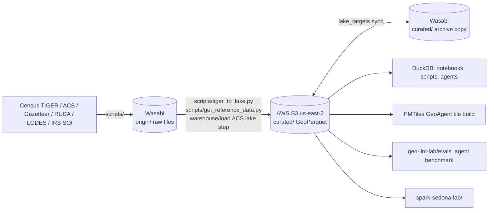

# GeoDataAnalytics

The data side of geospatial analytics. This repo covers acquiring US Census,
IRS and Copernicus data, landing it in object storage as GeoParquet,
querying it in place with DuckDB, and testing geospatial LLM agents against it.
There is no database server: the lake on S3 is the system of record.

It's the public "behind the scenes" for the data that powers
[GeoAgent](https://geoagent.app). App, user and infrastructure code lives
elsewhere. Nothing here depends on it.

## Segments

| Folder | What it is | Start here |
|---|---|---|
| [`warehouse/`](warehouse/) | Lake plumbing: `lake_targets.py` (AWS + Wasabi writers, `sync`), the ACS Summary File → Parquet loader, lake layout docs. The Postgres/PostGIS server that used to live here was retired on 2026-11-13; its schema and loaders are kept for reference. | `warehouse/README.md` |
| [`scripts/`](scripts/) | Acquisition and ETL CLIs: `tiger_to_lake.py` (TIGER zips → boundary GeoParquet, no database), `get_reference_data.py` (Gazetteer, ZCTA relationships, RUCA, LODES), TIGER/Census survey/IRS downloaders, Copernicus CDS/CDSE fetchers, boundary loader, streaming EAV ingest (`census_ingest_pipeline.py`), survey-documentation analysis. | `scripts/COPERNICUS_README.md`, `--help` on each CLI |
| [`utils/`](utils/) | Small shared helpers (FIPS codes, geometry, zip extraction) used by `scripts/` and `notebooks/`. | n/a |
| [`notebooks/`](notebooks/) | Data lab for exploring newly fetched data: H3 notebooks, a local-only JupyterLab stack, and a throwaway copy of the warehouse. | `notebooks/README.md` |
| [`spark-sedona-lab/`](spark-sedona-lab/) | Learning lab. Single-node Apache Spark + Sedona: spatial joins, GeoParquet partitioning, a Wherobots Airflow DAG. Applying the same skills on a different engine. | `spark-sedona-lab/README.md` |
| [`geo-llm-lab/`](geo-llm-lab/) | Benchmark for geospatial LLM agents: natural-language geo questions graded against gold SQL on the lake (`evals/`), with a Claude baseline, an HTTP contract for GeoAgent, and fine-tuning export. Older SQL suites alongside. | `geo-llm-lab/evals/README.md` |
| [`qgis-plugin-lab/`](qgis-plugin-lab/) | Learning lab for [`ee_s5p_plugin`](https://github.com/blcrosbie/ee_s5p_plugin) (a sibling repo): scenario-driven use cases — Sentinel-5P atmospheric monitoring, EO/IR fusion, GEOINT-style analysis — run against the live Earth Engine catalog from QGIS. | `qgis-plugin-lab/README.md` |
| `reports/` | Written findings and charts generated by the analysis scripts. Local only (gitignored) until a report is finalized. | n/a |
| `data/` | Local scratch only. Raw data lives in Wasabi under `origin/` (mounted read-only at `data/<bucket>/` via rclone when needed). | n/a |

## Where the data lives

| Location | Contents | Size |
|---|---|---|
| `s3://<bucket>/origin/` | Raw downloads: Census TIGER and surveys (ACS, decennial, PopEst, BRDS, economic census, gov finances, MHS), IRS SOI (county, ZIP, migration, congressional), Natural Earth | ~300 GiB, 210k files |
| `s3://<bucket>/curated/` | Boundary GeoParquet partitioned by `boundary_type/year`, with H3 + bbox keys; ACS 5-year; reference tables (Gazetteer, RUCA, ZCTA relationships, LODES). Identical copies on **AWS S3** (primary, serves GeoAgent) and **Wasabi** (archive). | see `warehouse/README.md` |

## Using the data from another repo or notebook

Read the Parquet straight from S3: `read_parquet('s3://<bucket>/curated/...')`
from DuckDB (with the `spatial` extension), GeoPandas (`gpd.read_parquet`),
Sedona or QGIS, with a read-only key for the AWS bucket (or the Wasabi archive).
Filter on `boundary_type`/`year` paths and the `h3_r5`/bbox columns before
touching geometry.

## Architecture

[`docs/GEO_FOUNDATION_ARCHITECTURE.md`](docs/GEO_FOUNDATION_ARCHITECTURE.md) covers which
the S3-only stack serves each workload (GeoParquet + DuckDB, PMTiles, and when a
PostGIS serving DB would be worth adding back), the geography data
model and crosswalks, drawn-shape analysis, the urban/rural method, and how the LLM uses it.

## Repo direction

See [`docs/REPO_SPLIT_PLAN.md`](docs/REPO_SPLIT_PLAN.md) for what stays, what
moves out, and the order of operations.

## License

MIT, see [LICENSE](LICENSE).
